# MIT 主楼：诗意校园样板交付记录

本页第 1–5 节保留首版风格样板的历史事实。2026-10-26 用户再次明确现实细节优先，最新修正与验证见第 6 节；不能沿用首版的材质简化方向作为当前标准。

日期：2026-10-26（Asia/Shanghai；报告时间戳使用 UTC）。版本：`poetic-campus-v1`。状态：**桌面与移动浏览器模拟均可试玩；作为风格阶段样板交付，未通过全部 G0–G4。**

## 1. 实际范围与制作类别

本轮按 [诗意校园 · 幻想写实](pulsetact-poetic-art-direction.md) 调整 MIT Building 10 / Great Dome、面向 Killian Court 的柱廊及相关庭院建筑表面。保留暖白/米白石材、绿色植被、自然日光和既有水色，借鉴用户 demo 的干净材质、结构明暗与轻柔氛围。

实际工作为 **既有几何的材质精修、局部构件补全、运行时表现与分级接入**。沿用 `public/data/killian/detail.glb` 和原主楼体块，没有重新建模整栋主楼，没有制作完整室内，也没有完成整个 MIT 校园的风格迁移。

- 石材、柱廊、檐口、铺装、玻璃、窗框、木门与窗内遮蔽使用分开的风格化材质；降低高频表面噪点，以暖浅色、少量石缝和明暗层次读出构造。
- 在原十根柱子的卷涡构件后补入连贯柱头实体；在既有鼓座饰带补充 128 条成对细肋与 320 个小垂饰。小尺寸依据照片估算，不声称测量精度。
- 草庭上加入少量暖色种子/叶片状微粒，保持既有草坪、步道与地形。未加入蓝白夜景、水淹庭院或破败遗迹。
- 桌面和移动资产加载路径已接入同一套材质与补充构件；移动初检发现旧分级资产缺少柱廊、窗门等核心结构；现已从完整源模型无损提取并接入独立补充资产，复验已通过。

## 2. 源文件与依据

| 项目 | 本轮来源与边界 |
| --- | --- |
| 主楼底座 | `public/data/killian/detail.glb`、`detail-manifest.json`；沿用现有 GIS/照片近似重建与既有锚点 |
| 材质程序 | `src/features/world/mit-poetic-materials.ts`；保留暖石材、玻璃、木门等分类与原有配色关系 |
| 构件程序 | `src/features/world/mit-main-building-detail.ts`；三组实例批次，柱头实体、鼓座细肋和小垂饰 |
| 氛围程序 | `src/features/world/mit-poetic-atmosphere.ts`；程序生成的局部微粒，支持减少动态与低画质数量缩减 |
| 场景接入 | `src/features/world/scene-assets-desktop.ts`、`src/features/world/mobile-campus.ts` |
| 实景依据 | `assets-source/killian-reference/maclaurin-front.webp`、`maclaurin-oblique.webp`、`portico-study.json`；来源与用途见 [参考清单](mit-realism-references.json) |
| 风格依据 | 用户提供的 `98990c5f7ad818e5361681d117cfdb19.mp4`；只提供表现语言，不作为 MIT 的几何事实 |

本轮保留可编辑程序源和参数，**没有新建 Blender 母版**。原模型与新增实例在运行时装配，没有将本轮新增构件另行烘成新的完整主楼 GLB。固定机位报告记录了所加载底座的 SHA-256：`detail.glb` 为 `42fbe183da2306dcd235b8da990bffe3eb8997720fee464f5adf81183b9b662d`；`detail-manifest.json` 为 `9dc267e9b00a5acccf4ef112a4c036d8e606b6623ebcd3b17cd856629cc601d8`。

新增程序、加载器、源模型与移动导出的完整 SHA-256 记录已保存于 [源与导出清单](screenshots/mit-poetic/source-manifest.json)。移动导出生成源为 `scripts/prepare-mit-mobile-portico.mjs`，资源清单为 `public/data/killian/mobile-portico.json`。参考照片仅用于本地视觉研究，本轮未将其作为新纹理分发，也未使用图像生成结果充当模型或验收画面。

## 3. 画面证据

### 固定相机的资产检查

以下画面由实际 world 资产加载器及 Boston 日光配置渲染，使用固定检查相机、无玩家 HUD。它们用于比较资产表现，**不单独证明完整游戏可玩**。尺寸 1600×1000，DPR 1，曝光 1；相机、FOV、灯光与源 hash 见 [固定机位记录](screenshots/mit-poetic/camera-lock.json)、[修改前报告](screenshots/mit-poetic/before-report.json)、[本轮报告](screenshots/mit-poetic/after-report.json)。

| 修改前 / 同一 02 机位 | 本轮版本 / 同一 02 机位 |
| --- | --- |
| 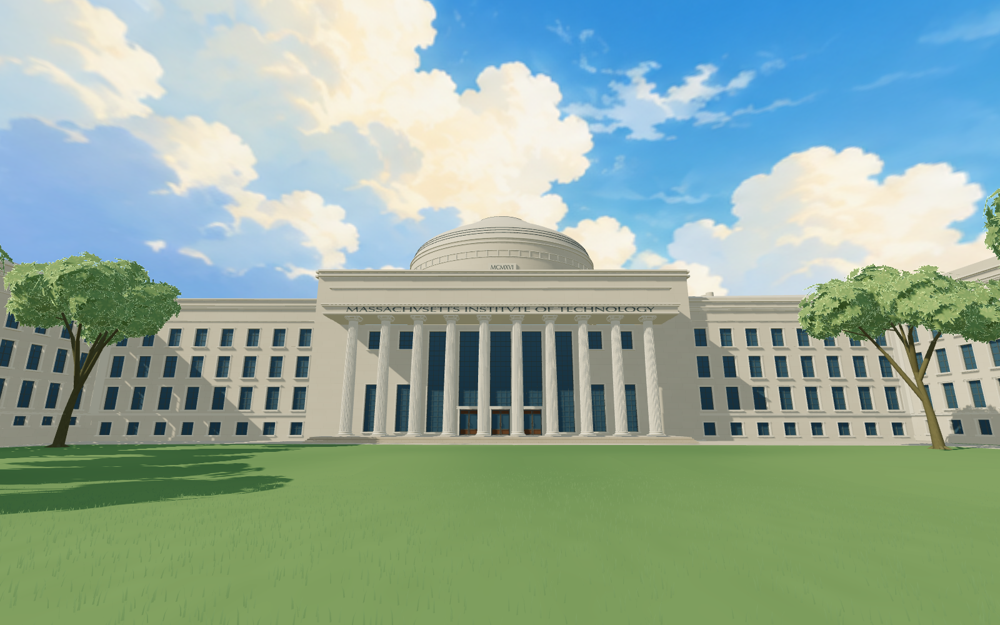 | 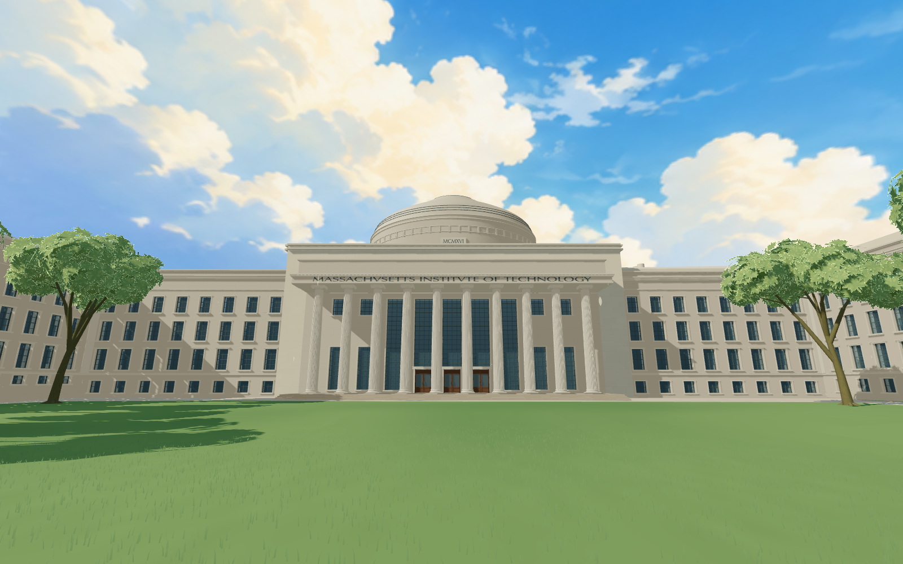 |

补充的 06、07 机位没有修改前同机位，不作为前后对比：

| 庭院内斜视 / 本轮补充 | 柱头实体与梁底近景 / 本轮补充 |
| --- | --- |
| 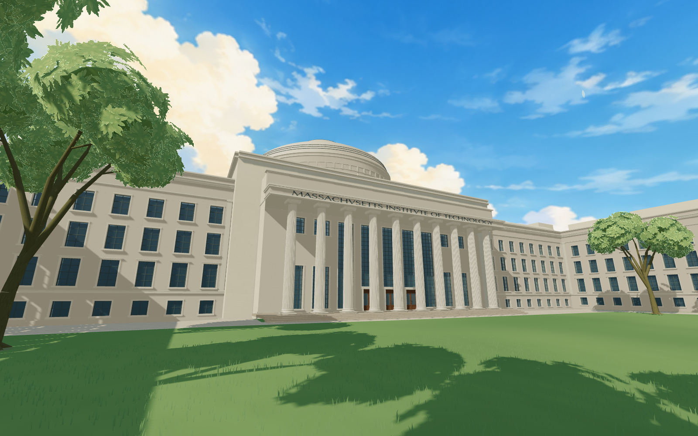 | 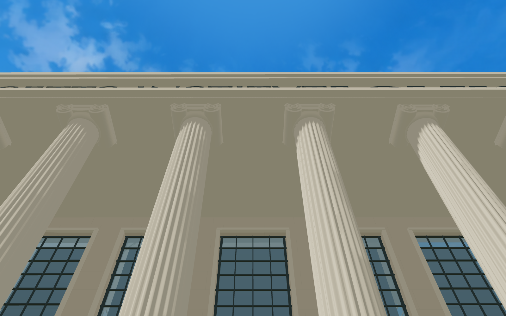 |

原 `04-court-oblique` 机位被侧翼建筑遮挡，不显示有效主楼范围，已排除出验收与展示；编号保留于历史机位记录中。实景照片与以上检查机位不是精确配准，不能据此声称像素级还原。

### 完整游戏中的游玩检查

[游玩报告](screenshots/mit-poetic/playable-report.json) 来自本地完整应用：真实登录、开始校园漫游、正常 WASD/加速、正常拖拽镜头、走上五级台阶，并通过设置在标准/低画质之间切换。报告 `errors` 为空。

| 游戏内仰视穹顶 | 游戏内接近柱廊台阶 |
| --- | --- |
| 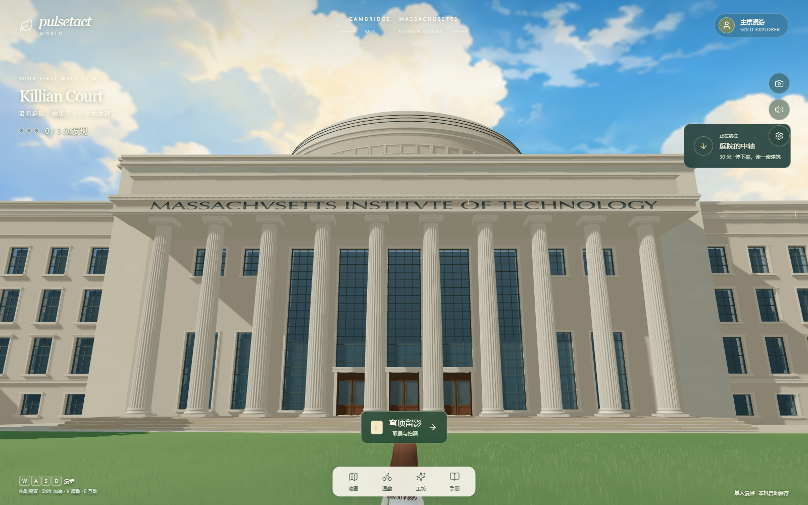 | 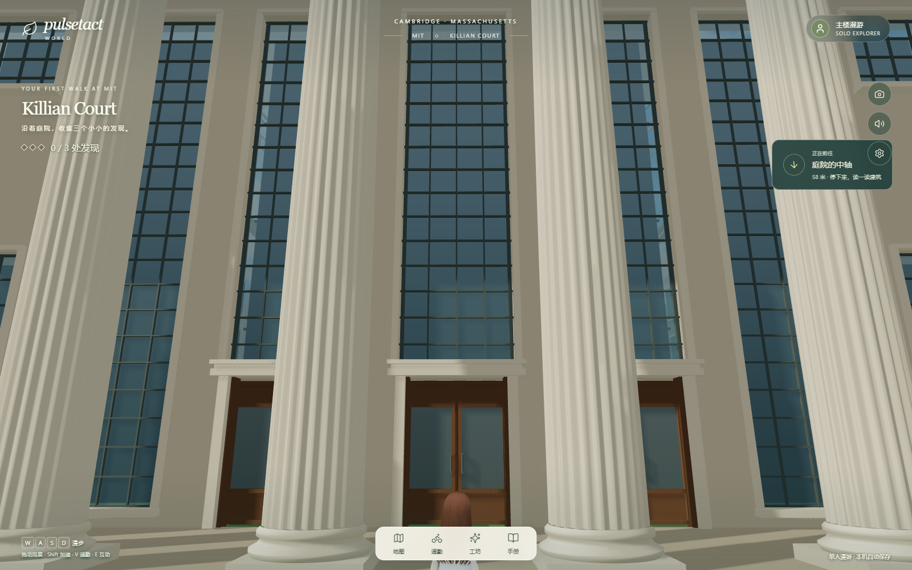 |

实测从庭院走到柱廊台阶，再到平台；平台角色位置为 `[12.45819, 4.86499, -35.53527]`，切换低画质后位置不变。该路线验证了已测试台阶与标准/低画质的地面一致性，不代表完整室内开放或所有路线均已检查。

### 移动浏览器模拟复验

[完整游戏移动模拟报告](screenshots/mit-poetic/playable-mobile-report.json) 在 430×932、DPR 1、移动模式下完成真实登录、同一路线行走、上台阶，以及省电→HD→省电切换；浏览器与着色器错误为空。使用桌面 GPU 和键盘自动操作，不构成手机真机或触控操作验收。报告历史字段 `low` 在该次移动运行中对应切换后的 `quality: standard`；05 图片因此不作为省电图展示。

| 移动游戏内主楼 | 移动游戏内柱廊门窗 |
| --- | --- |
| 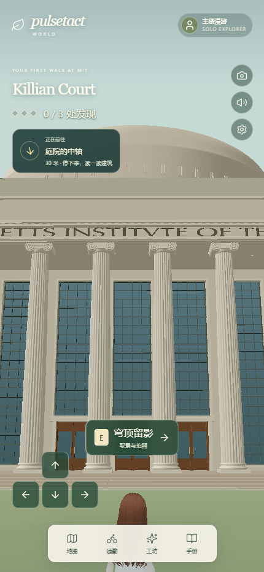 | 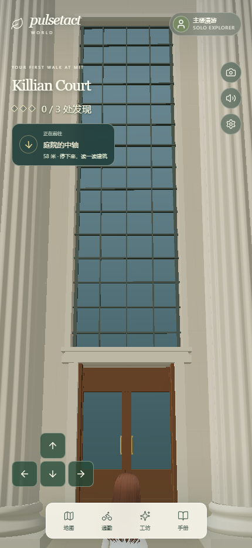 |

恢复后的 [移动固定机位报告](screenshots/mit-poetic/mobile-report.json) 同时验证柱廊、窗框与门扇已加载。旧 `output/mit-poetic/mobile/` 是补全前的缺柱诊断，不作为当前结果。固定机位使用宽屏检查视口，完整移动游戏截图使用上述竖屏视口。

## 4. 技术、分级与资源记录

相关 4 个测试文件、12 项自动测试及生产构建已通过，包括移动 GLB 的真实解析、源三角位置保持、10 根柱的位置/高度、碰撞标记和导出 hash。可复现检查入口为 `scripts/capture-mit-poetic.mjs` 和 `scripts/check-mit-poetic-playable.mjs`，需本地服务与已有登录环境。

| 项目 | 当前记录 |
| --- | --- |
| 既有完整底座传输文件 | `detail.glb` 56,841,004 字节；该文件包含既有 Killian 增强层，不能全部归为本轮新增 |
| 新增结构几何 | 22,736 个实例化可见三角形，3 个绘制批次；10 个柱头实体、128 条鼓座细肋、320 个小垂饰 |
| 新增结构低档取舍 | 保留柱头轮廓和鼓座细肋；隐藏高处小垂饰，不参与碰撞 |
| 氛围数量 | 桌面标准最多 72 个；低档/移动最多 24 个，局部范围显示，不产生地面或碰撞 |
| 游玩平台标准档 | 132 draw calls，1,344,603 个场景可见三角形；包括周边场景，不是主楼单体数据 |
| 游玩平台低档 | 100 draw calls，1,017,459 个场景可见三角形；角色位置与平台高度保持一致 |
| 帧样本 | 110 个样本，中位数 8.4ms，P95 14.3ms；Chrome headless、1600×1000、DPR 1、开发服务器、柱廊静止采样 |
| GPU / 限制 | ANGLE / NVIDIA GeForce RTX 5090 / D3D11；该静止样本不构成目标设备稳定帧率承诺 |
| 移动柱廊补充文件 | `mobile-portico.glb` 1,902,028 字节；108,644 个三角形，77,376 个顶点，12 个网格，0 张新增纹理；保留源位置/三角形，仅去重顶点和量化法线 |
| 移动平台省电 / HD | 57 / 58 draw calls；377,239 / 384,919 个场景可见三角形；柱廊、门窗与平台接地保留 |
| 移动状态 | 柱廊补回后，固定检查相机与完整游戏浏览器模拟复验通过；**移动真机与真实触控未验证** |

尚缺完整的目标设备路线帧时间、加载/切换时间、纹理解码占用与移动资源归档，本轮不作完整性能验收声明。

## 5. G0–G4 与剩余差距

| 检查 | 当前状态 | 证据与待补内容 |
| --- | --- | --- |
| G0 参考与范围 | 部分完成 | 已明确 Building 10 外观样板范围、旧版基线、已有正面/斜视照片和风格来源；近景构件的小尺寸仍为照片推定，未完成全部方向的重新核对 |
| G1 形体与接地 | 部分完成 | 沿用既有底座并补局部构件；新增构件锚点、有限坐标和碰撞排除有测试，游戏台阶路线通过；没有完成整栋主楼中性材质/全方向重新校准 |
| G2 构件与材质 | 阶段样板 | 暖色干净石材、柱头实体和鼓座细部已进入运行画面；玻璃仍是简化反射表达，窗后空间与近景材料层次仍需继续核对，不视为完整实景材质重建 |
| G3 实际游玩 | 已测桌面与移动模拟路线通过 | 完整游戏登录、走近主楼、台阶与标准/低画质切换通过；同一路线的移动浏览器模拟及省电/HD切换也通过；背面和所有侧向路线未完成本轮验证 |
| G4 分级与交付 | 未完成 | 已保存程序源、底座与移动导出 hash、持久截图、桌面及移动模拟报告和基础资源记录；目标设备路线帧时间、加载/解码占用与移动真机检查仍待补齐 |

视觉结论：当前画面已形成保留原有配色的干净校园样板，主楼柱廊与穹顶在所保存机位中可辨；表面风格和局部构件较基线发生了明确变化。既有主体、窗格和部分细部仍承接历史近似模型；本轮不是整楼重建，也未达到“范围内全部验收通过”。后续继续补充主楼侧向与近景核对、玻璃深度表现以及目标设备的完整性能证据。

## 6. 2026-10-26：现实细节优先的修正

用户明确“我还是需要尽可能地还原现实细节”。本轮为**材质精修、局部构件补全及反射运行时调整**：恢复被首版过度简化的表面层次，保留自然暖色配色。没有重建整栋主楼，没有改变地形、开洞或原有可行走路线。

- 石材按既有 `portico-study.json` 的照片推定尺度恢复 1.25×0.55 米分块；增加克制的块间色差、毫米级接缝/颗粒凹凸和沿墙脚、檐口的局部积尘。单块边界与污渍分布为程序近似，并非精确测绘或扫描纹理。
- 取消把建筑受光压成大色块的处理，恢复连续 PBR 明暗；铺装分缝、石面变化与木门细纹保留。窗框依据照片调整为受光可读的暖灰色，不采用统一黑线。
- 桌面三类主楼玻璃保留真实框体、窗洞进深和后方遮蔽，并使用物理玻璃参数；首次近距离可见时捕获实际庭院场景，生成 128px 立方反射与过滤环境图；相机远截面限定 220 米，天空保留，远处校园不参与此次捕获。运行报告确认捕获一次、无错误。它是共享静态反射，未实现每窗视差、动态人物倒影或真实室内透射。
- 依据 `maclaurin-front.webp` / `maclaurin-oblique.webp` 补入字带两端的 2 个花环浮雕（56 片叶）和 3 组凸出门头。既有柱槽、柱础、卷涡、开口、窗格及拉手保留；小尺寸与顶部装饰轮廓为照片推定，未伪称精确雕刻复刻。
- 低档保留门头与花环主体轮廓，隐藏微小叶片/高处小垂饰；桌面低档可复用已生成的反射缓存，但不首次分配。移动保留石材分缝、块差及真实几何，省略细微法线凹凸，玻璃继续使用有说明的近似反射；未接入桌面反射通道。

### 本轮画面与来源

以下为相同检查机位与日光的实际运行资产截图。第 1–5 节及 `screenshots/mit-poetic/` 保留上一版，未覆盖历史证据。照片与游戏相机并未精确配准。

| 实景细节依据 | 本轮柱廊近景 |
| --- | --- |
| 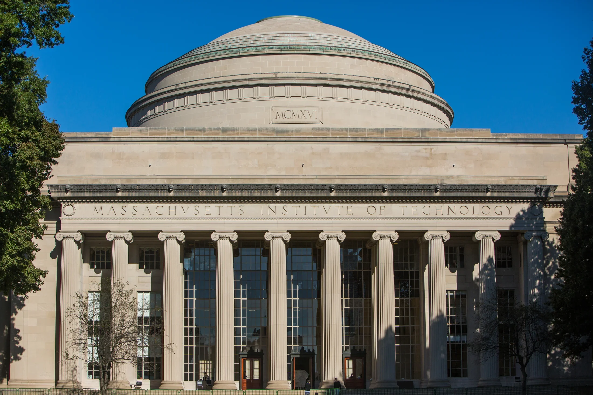 |  |

[固定机位与反射记录](screenshots/mit-real-detail/fixed-report.json) · [完整游戏路线报告](screenshots/mit-real-detail/playable-report.json) · [源文件与资产 hash](screenshots/mit-real-detail/source-manifest.json)。可编辑源为 `mit-poetic-materials.ts`、`mit-main-building-detail.ts`、`mit-glass-reflection.ts`；沿用原始主楼和移动柱廊 GLB，本轮未改其几何文件。

### 技术与视觉状态

5 个测试文件共 16 项通过；生产构建通过。桌面完整游戏中真实登录、走到主楼、登台阶和标准/低画质切换通过，浏览器与着色器错误为空。固定机位验证实际反射已生成。移动浏览器模拟的同一路线与省电/HD切换也通过，错误为空，见 [移动模拟报告](screenshots/mit-real-detail/mobile-playable-report.json)；该检查使用桌面GPU与键盘操作，真机和真实触控尚未验证。

补充构件累计 29,680 个实例化可见三角形、7 个绘制批次，相比首版增加 6,944 个三角形与 4 个批次；同一主立面机位由 112 增为 116 draw calls。反射为一次性 6 面捕获加过滤，不是每帧重复捕获；无新增下载纹理，本轮未直接测量显存占用。最终主立面固定机位记录 131 个已上传几何、44 个纹理；该计数不能当作显存字节。桌面游戏平台的资源、帧样本、设备与画质参数随最新源清单保存，不构成手机真机帧率承诺。

视觉状态为**现实细节恢复后的阶段可试玩版本**。石材、铺装和入口层次已有恢复，但柱头中央雕刻、檐口连续刻饰与凸出装饰、精确木作、各窗实际室内深度仍有差距；共享反射不能替代逐窗视差。现有主体与未覆盖立面没有完成新一轮全面实景校准，G0–G4 不能整体标记通过，也不能把本轮称为整栋真实重建完成。

## 7. 2026-10-26：校园接触遮蔽与侧翼核查

本轮为**运行时光照表现调整与实景依据核查**，不是形体重建。用户要求继续完善 MIT，并询问与《现代战争》写实画面的差距。主楼和移动柱廊 GLB、碰撞、原有暖色配色及日光参数保持原样。

### 本轮实现及边界

`mit-scene-renderer.ts` 为桌面标准档、Killian Court 周边 260 米内加入 GTAO 接触遮蔽，重点改善柱础、窗洞、框体、台阶和檐口交接处。原始画面先照常渲染，再温和叠加屏幕空间遮蔽；半径 0.65 米、厚度 0.20 米、强度 0.38、16 个采样，遮蔽尺寸为绘制缓冲的 0.65 倍，最长边不超过 1280。透明玻璃、裁切叶片和自定义天空着色器不写入该通道的实体深度，避免被误画成遮挡墙面。

该效果采用显示空间乘色近似，**不产生间接光照，不是 GI，也不能补足缺失几何或真实表面数据**。保留原始抗锯齿与逐材质色调映射，没有二次 ACES。标准/低档、范围进入/离开及卸载有资源释放路径；移动端不启用该通道。游戏拍照事件同步使用同一渲染路径。

侧翼核查记录位于 `assets-source/killian-reference/courtyard-detail-audit-20261026.json`。既有六个庭院立面的窗洞已经有 0.64 米实体墙厚、0.32 米玻璃退进、窗框和窗台，因此撤回重复添加窗洞内衬的方案。真正未完成的是逐立面窗列校准、特殊端墙入口、实景树形和家具位置。新增 MIT OCW 的 NEWTON 端墙参考及来源/hash；其在模型中的准确立面 ID 尚未确定，未据此猜造入口位置。

### 同机位对比与游戏验证

| 本轮修改前（关闭接触遮蔽） | 本轮版本（开启接触遮蔽） |
| --- | --- |
| 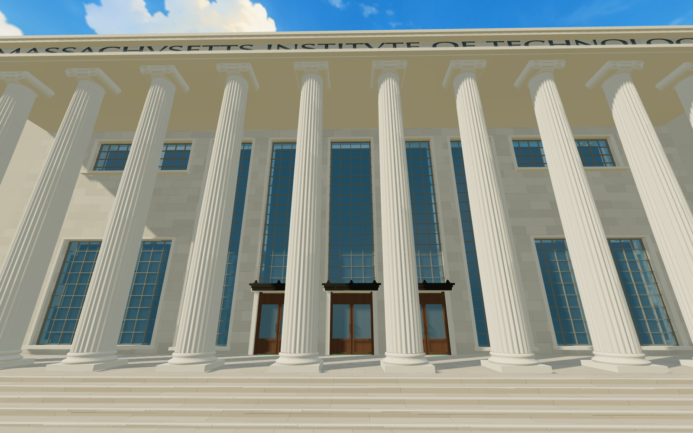 | 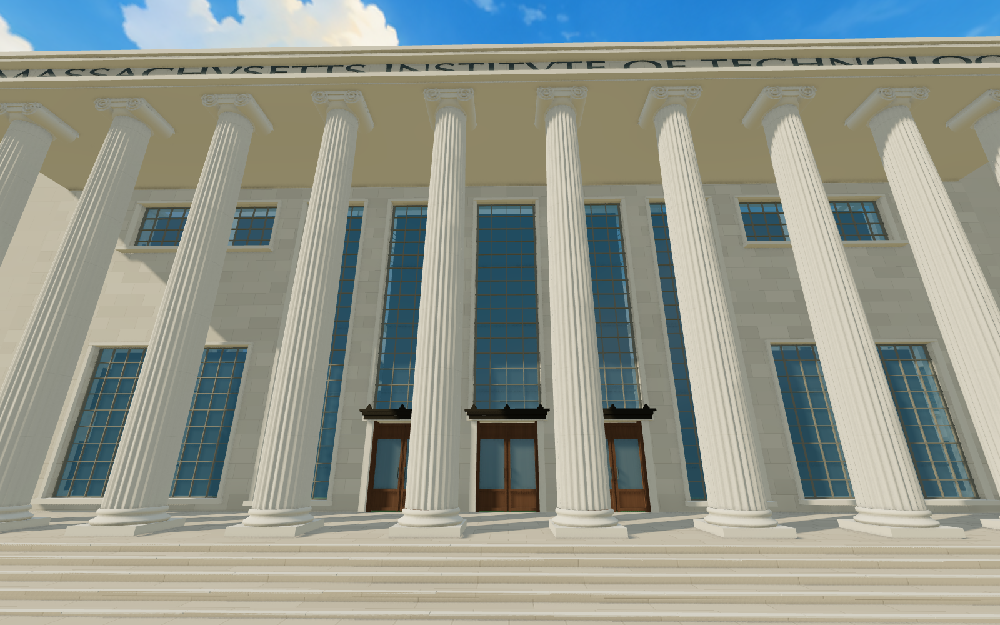 |

六个固定机位使用相同资产、光照、曝光、分辨率及相机；属于实际资产加载器与游戏渲染通道的检查画面，不是完整游戏游玩截图。06/07 在最早历史版本中是补充机位，但本节已经同时保存开关两种状态，可作本轮对比。固定图可观察到柱础与门窗交接处的局部层次改善，整体仍有明显模型感；玻璃深度、石材材质、植物与绘画天空尚未达到现实级一致性。

[关闭效果的固定机位报告](screenshots/mit-contact-occlusion/before-report.json) · [开启效果的固定机位报告](screenshots/mit-contact-occlusion/after-report.json) · [完整桌面游戏报告](screenshots/mit-contact-occlusion/playable-report.json) · [移动浏览器模拟报告](screenshots/mit-contact-occlusion/mobile-playable-report.json) · [源文件与证据 hash](screenshots/mit-contact-occlusion/source-manifest.json)。

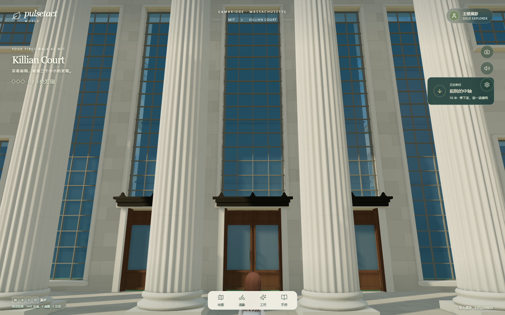

桌面完整游戏完成真实登录、庭院行走、登台阶、标准→低档→标准、窗口缩放及同步拍照事件检查，浏览器和着色器错误为空。确认低档释放遮蔽资源，恢复标准档后重新分配；1600×1000 时遮蔽缓冲为 1040×650，缩到 1280×800 时为 832×520。移动浏览器模拟完成同一路线及省电/HD切换，并确认仍走直接渲染；不代表手机真机或触控验收。

相关 6 个测试文件共 20 项通过，生产构建通过。构建仍有既有大分包提示；新增渲染动态分包约 28.93 kB / gzip 7.21 kB。主立面固定机位整帧绘制由 188 次 / 2,010,165 三角形变为 294 次 / 3,130,263 三角形，增加部分来自同一几何的法线/深度绘制，并非模型新增了一百多万三角形。GPU 纹理计数由 44 变为 50（含渲染目标和噪声纹理），不能当作显存字节。这里开关两份报告都统计整帧，不能直接与旧报告的单次 beauty 计数比较。未测目标设备性能，保存的 RTX 5090 开发环境帧样本只作诊断，不作性能承诺。

### G0–G4 与下一步范围

G0 增加侧翼参考与明确未知项，尚未完成逐面定位；G1 本轮没有重建；G2 改善了已存在构件的接触层次，真实材料和间接光仍有缺口；G3 上述桌面与移动模拟路线通过；G4 已保存源、hash、分级行为和运行证据，真机及完整资源预算仍待补。**整体视觉验收仍未通过。**

继续制作应以“主楼入口—柱廊—庭院侧翼”的连续步行范围为样板：先逐面校准真实几何，再制作有依据的石材/木作/玻璃材质，建立间接光照和反射、统一植物与天空的真实感，最后按距离与设备生成分级。不要再以给旧近似几何添加零散装饰作为主要还原方法。

对《现代战争》系列的判断参考 Activision 官方的 [2019 摄影测量制作访谈](https://blog.activision.com/call-of-duty/2019-06/Initial-Intel-How-Photogrammetry-is-Helping-to-Shape-Call-of-Duty-Modern-Warfare-into-a-new-high-watermark-for-graphics-in-gaming)、[2021 大规模全局光照技术](https://research.activision.com/publications/2021/09/large-scale-global-illumination-in-call-of-duty) 和 [2020 内容分级技术](https://research.activision.com/publications/2020-09/lima-oscar-delta--scaling-content-in-call-of-duty--modern-warfar)。这些证明系列在真实数据、光照与资源组织方面的积累，不能据此声称 MW4 的整座巴黎都是扫描得到，或断言其具体采用了哪种光追方案。
