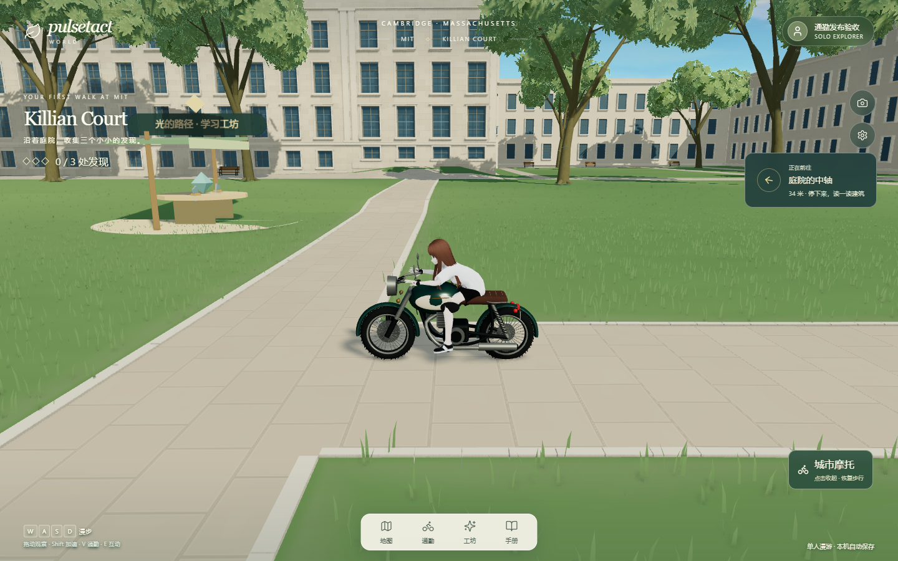
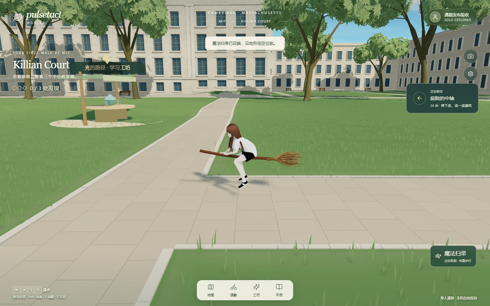

# 载具补发 · 2026-10-29

目标分支：`develop`。正式站点：<https://world.pulsetact.ai/>。

本轮补发此前留在本地的城市摩托与魔法扫帚。上一轮 MIT／BU 校园部署 `90c6fa27-bcb9-4e30-93bf-0a8f92b9ebda` 没有载具；本轮保留该校园更新，并接入通勤菜单、召唤／收起、骑姿、轮胎转动、加速、碰撞与手机触屏操作。音频和 Boston Downtown 的其他开发仍在本地，未包含在本次载具补发包中。

进入校园后点击底部「通勤」，或在电脑按 V，选择「城市摩托」或「魔法扫帚」。WASD／方向键移动，Shift 加速；手机使用方向按钮并按住「加速」。扫帚沿可通行地形低空移动，不能自由飞越建筑和水面。快速旅行、返回入口、进入室内及重新打开页面时恢复步行。

## 资产与状态

本轮属于运行时功能交付，使用既有原创程序化载具及可恢复的骨骼姿态叠加，不声称重建了特定品牌的真实车辆。母版为 [模型生成源](../../src/features/world/commute-vehicle-model.ts) 和 [骑姿源](../../src/features/world/character-riding-pose.ts)，坐标为米、Y 向上、+Z 朝前。参考、设计与未知细节见 [来源记录](../../assets-source/commute/source-manifest.json)。没有新模型下载依赖或外部纹理。

| 资产 | 三角形 | 材质批次 | 尺寸（米） |
| --- | ---: | ---: | --- |
| 原创城市摩托 | 39,720 | 16 | 0.900 × 1.265 × 2.232 |
| 原创魔法扫帚 | 22,080 | 7 | 0.455 × 0.375 × 2.294 |

桌面、低画质和手机共用相同载具几何；没有把降低阴影或渲染分辨率称作减面 LOD。场景与人物继续使用已有移动分级。手机真机性能尚待验证。

当前状态为**阶段可试玩**，不标记 G0–G4 完整视觉验收通过。G0 已记录通用摩托参考与原创虚构扫帚设计；G1/G2 保留程序源、尺寸、材料分区，但仍有简化的轮胎细节、线缆和仪表字样；G3 的实际发布版截图与操作结果随部署归档；G4 已记录几何预算及分级方式，真机帧时间和完整近景实景对照待补。测试通过不等于最终真实感达标。

## 技术验证

补发包从仅含本轮载具改动的 Git 暂存快照导出构建，未直接发布混合开发工作区。TypeScript、生产构建与 Cloudflare 打包通过，整套 521 项测试全部通过。载具相关的 14 项覆盖薄墙扫掠、斜向滑动、暂停帧距离上限、有限几何、资源释放，以及两个人物／两种载具连续 240 帧骑姿恢复与接触点检查。构建仍提示已有大 JS 分块。

已发布代码提交 `51445c0`，正式部署版本 `9f74ff78-e946-4dc7-9617-97eda0838881`。线上桌面 7 项、手机模拟 7 项检查均通过，确认正常登录、MIT 到达、两类载具召唤／移动／加速／收起、快速旅行与重载恢复步行；最终检查无页面、WebGL 或资源错误。首页与全部 38 份 JS／CSS 共 39 个线上文件与已验收包的 SHA-256 一致。发布目录共 131 个资源、265,512,891 字节，为全站清单而非首次下载量。

第一次部署遇到 Cloudflare OAuth 刷新网络错误，使用本机 IPv4 代理重试成功。首次线上手机检查遇到登录服务连接错误，未进入载具检查；新建独立手机会话复验通过。原失败记录保留，没有修改登录逻辑或绕过检查。

人工检查正式站点的侧面截图，摩托轮胎接地、扫帚低空悬浮，骑姿和操作入口可见。扫帚正面被人物明显遮挡，侧面用于检查其形体；手部／衣物近景、材质微细节及真机性能仍待继续，未改为最终视觉验收通过。

[发布验证](evidence/commute-20261029/verification.json) · [桌面](evidence/commute-20261029/desktop.json) · [手机模拟](evidence/commute-20261029/mobile.json) · [线上文件 SHA-256](evidence/commute-20261029/assets.json)

